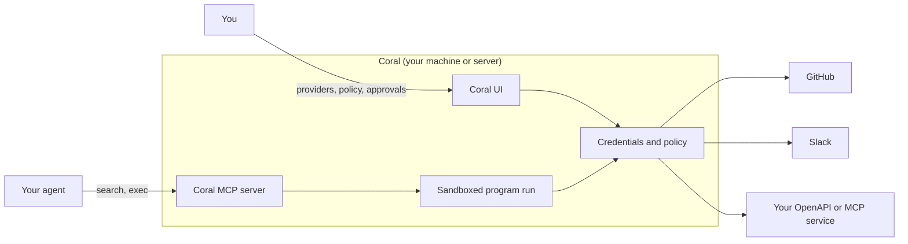

# Coral

**One MCP server for every service your agents use, with your credentials and
your rules.** Agents write short TypeScript programs. Coral runs them in a
sandbox, adds the credentials, and checks every call against your policy.

[](https://github.com/withcoral/coral/actions/workflows/ci.yml)
[](./LICENSE)
[](https://withcoral.com/docs)
[](https://withcoral.com/discord)

## Why Coral

Connecting an agent to many services usually means many MCP servers, a token
pasted into each one, and every tool definition loaded into every prompt.
Coral replaces that with one server:

- **Smaller context, fewer round trips.** The agent searches for the
  operations it needs instead of loading them all up front. It then sends one
  program that can call several operations and return only the fields the
  answer needs.
- **Agents build on what already worked.** When a program works, the agent
  saves it as a function. The next time, it calls that function in one step
  instead of finding the operations and writing the program again. Saved
  functions are typed and appear in search alongside provider operations.
- **Agents never hold credentials.** Coral stores your tokens and adds them to
  each call. Programs run in an isolated sandbox with no secrets, no network
  access, and no imports.
- **You decide what runs.** Set each operation to allowed, approval required,
  or disabled. A call that needs approval waits until a person approves it.
- **Every run is recorded.** Review each program and the calls it made in the
  Coral UI.
- **You host it.** Run Coral on your laptop or on your own server. Your data,
  credentials, and usage history stay with you.

Coral includes setup recipes for GitHub, Linear, Jira, Notion, Gmail, Stripe,
Datadog, Sentry, HubSpot, and more. You can add any service that has an
OpenAPI document or an MCP server.

## Get started

1. **Install Coral.** Download the desktop app for macOS, Linux, or Windows
   from the [releases page](https://github.com/withcoral/coral-releases/releases),
   or [run a shared server](https://withcoral.com/docs/getting-started/self-host)
   for your team.
2. **Add a provider.** A provider is one service your agents can use. Pick one
   from the catalog, or bring your own OpenAPI document or MCP server. See
   [Add a provider](https://withcoral.com/docs/getting-started/quickstart#add-a-provider).
3. **Connect your agent.** Each workspace in Coral has its own MCP URL. Copy it
   from the Coral UI and add it to your MCP client:

    ```bash
    claude mcp add --scope user --transport http coral <your-mcp-url>   # Claude Code
    codex mcp add coral --url <your-mcp-url>                            # Codex
    ```

    For Cursor, VS Code, OpenCode, and other clients, see
    [Connect an MCP client](https://withcoral.com/docs/getting-started/quickstart#connect-an-mcp-client).

Now ask your agent something that needs that provider, such as "What are my
open pull requests?"

Setup guides and the configuration reference are at
[withcoral.com/docs](https://withcoral.com/docs).

## How Coral works



The agent searches for the operations it can use and reads their TypeScript
signatures. Then it sends Coral a short program. This one finds open pull
requests that have no reviewer and posts them to Slack:

```ts
const { data: pulls } = await coral.providers.github.pulls.list({
    owner: "withcoral",
    repo: "coral",
    state: "open",
});

const unreviewed = pulls.filter((pull) => pull.requested_reviewers.length === 0);

await coral.providers.slack.chat.postMessage({
    channel: "#engineering",
    text: unreviewed.map((pull) => `#${pull.number} ${pull.title}`).join("\n"),
});

return unreviewed.map((pull) => pull.number);
```

Coral adds the credentials and checks each call against your policy. If
posting to Slack requires approval, the run pauses there until you approve it.
Only the pull request numbers go back to the agent, not the full GitHub
response. Once this works, the agent can save it as a function, and later
programs call it as `coral.functions.<name>()`.

To learn about providers, accounts, policy, and workspaces, read
[Concepts](https://withcoral.com/docs/guides/concepts).

## Upgrade from Coral 0.x

Coral 1.0 replaces the SQL interface with TypeScript programs. It is a rewrite
and starts from fresh state: it does not convert what 0.x stored, and it tells
you at startup if it finds 0.x state. See
[Upgrade from Coral 0.x](https://withcoral.com/docs/getting-started/self-host#upgrade-from-coral-0-x).

## Development

To run Coral from a checkout, follow the
[development guide](./docs/development.md).

## Community

Ask questions, share ideas, and show what you built in our
[Discord](https://withcoral.com/discord) or on
[GitHub issues](https://github.com/withcoral/coral/issues).

## Security

Do not report security issues in public issues or pull requests. See
[`SECURITY.md`](./SECURITY.md).

## License

Coral is licensed under the Apache License 2.0. See [`LICENSE`](./LICENSE).
