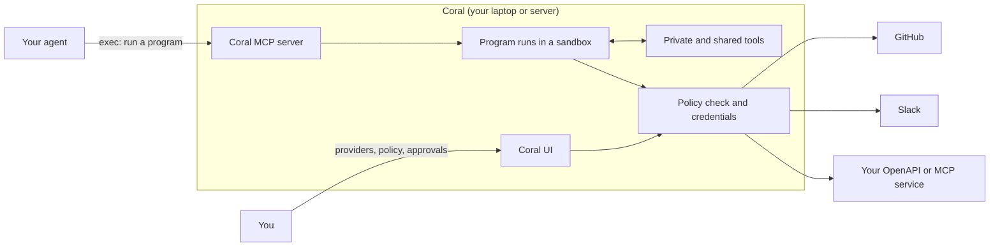

# Coral

**Execution rails for agents.**

Coral gives your agents execution rails for work with sensitive enterprise
systems. It's self-hosted, open source, and you can use it with any agent and
any system with an API.

**More precise permissions control.** As your agents do work across more
systems, mapping identities to MCP tools is no longer sufficient to control
risk. Permissions are all or nothing per tool so if an agent can call
`update_record`, it can update any record in any way the tool allows. With
Coral it's easy to define with code what specific actions an agent can take.

**Less duplicated agent work.** Agents start every task from scratch. They
re-read tool schemas, retry failed calls, and spend tokens rewriting code for
steps they got right yesterday. With Coral, your agents build and reuse a
shared library of proven tool-calling code.

Coral is now used by thousands of developers at more than 450 companies for
safer, more efficient agent work in customer support, SecOps, business
intelligence, SRE and more.

[](https://github.com/withcoral/coral/actions/workflows/ci.yml)
[](./LICENSE)
[](https://withcoral.com/docs)
[](https://withcoral.com/discord)

[Quickstart](https://withcoral.com/docs/getting-started/quickstart) ·
[Download](https://github.com/withcoral/coral-releases/releases)

In this example, an agent posts unreviewed PRs to Slack for the first time. The
agent searches for tools and runs a program. It isn't allowed to post to Slack
without approval, so the user approves it before it posts. Coral saves the
workflow as a private tool. The next day, the agent runs the same task by
calling that private tool.


## Get started

1. **Install Coral.**
    - **For yourself:** download the desktop app for macOS, Linux, or Windows
      from the [releases page](https://github.com/withcoral/coral-releases/releases).
    - **For your team:** [run a shared server](https://withcoral.com/docs/getting-started/self-host)
      with Docker Compose or Kubernetes.
2. **Add a provider.** A provider is one service your agents can use, such as
   GitHub or Linear. Pick one from the catalog, or bring your own OpenAPI
   document or MCP server. By default, tools that read data run right away and
   everything else needs your approval. See
   [Add a provider](https://withcoral.com/docs/getting-started/quickstart#add-a-provider).
3. **Connect your agent.** Copy your workspace's MCP URL from the Coral UI and
   add it to your MCP client:

    ```bash
    claude mcp add --scope user --transport http coral <your-mcp-url>   # Claude Code
    codex mcp add coral --url <your-mcp-url>                            # Codex
    ```

    For Cursor, VS Code, OpenCode, and other clients, see
    [Connect an MCP client](https://withcoral.com/docs/getting-started/quickstart#connect-an-mcp-client).

4. **Ask a question.** Ask your agent something that uses that provider, such
   as "What are my open pull requests?" Once a task works, your agent saves it
   as a private tool it can run in one step next time.

## Why Coral

MCP tool scopes are often broader than an agent use case requires, and agents
waste time and tokens repeatedly figuring out how to do work that's been done
before. Coral addresses these problems by saving proven tool-call programs in
libraries of reusable tools. Private and shared tools improve how your agents
access your data and execute work:

- **Precise control.** You can limit agents to approved tools only, not
  everything an MCP tool permits. Security approves "look up an order's refund
  status," not the whole payments API.
- **Cheaper models, same accuracy.** With saved tools, a smaller model
  performs like a bigger one. For many tasks, this means Opus 5.5 accuracy at
  Haiku 5.5 cost.
- **Faster, leaner agents.** With saved tools, agents finished work 30%
  faster and at 32% lower token cost on average.
- **Training data you own.** Each run leaves a structured trace of the goal,
  the tool used and the outcome that works well for post-training your own
  model.

From one developer's laptop to an enterprise cloud, Coral fits your stack:

- **Runs on your infrastructure.** Coral runs anywhere from a laptop to your
  own cloud, with zero data egress.
- **Open source.** Coral is Apache 2.0. Coral Enterprise adds
  organization-wide governance and support.
- **Any agent, any system.** It works with any AI app or agent that supports
  MCP. You can connect anything with an MCP server or OpenAPI spec, including
  more than 5,000 databases and SaaS tools.

## How Coral works

**Agents write programs.** To use tools, an agent writes a short TypeScript
program. One program can call several tools, filter the results and return
only what the task needs. Less raw data passes through the model's context.

**Coral runs them on rails.** Each program runs in a sandbox, system
credentials never appear in the agent's context or code, and every call is
checked against your policy before it reaches the system behind it. Policies
can also require a person to approve it.

**What works becomes a tool.** When a program succeeds, the agent saves it as
a private tool. Your library of proven tool-calling code grows with each
task. Agents search that library and reuse and edit those tools, and an owner
publishes them as shared tools for your team instead of starting over.

**Agents never hold credentials.** Coral stores your tokens and adds them to
each call. Programs run in an isolated sandbox with no secrets, no network
access, and no imports, and every run is attributed to the person or agent
that started it.



The agent sends Coral programs through the `exec` tool. A program calls
`coral.search` to find the tools the agent can use and read their
TypeScript signatures. Then the agent sends a program that does the work.
This one finds open pull requests that have no reviewer and posts them to
Slack:

```ts
const { data: pulls } = await coral.providers.github.pulls.list({
    owner: "withcoral",
    repo: "coral",
    state: "open",
});

const unreviewed = pulls.filter((pull) => pull.requested_reviewers.length === 0);

await coral.providers.slack.chat.postMessage({
    channel: "#engineering",
    text: unreviewed.map((pull) => `#${pull.number} ${pull.title}`).join("\n"),
});

return unreviewed.map((pull) => pull.number);
```

Coral adds the credentials and checks each call against your policy. If
posting to Slack needs approval, the run pauses there until you approve it.
Only the pull request numbers go back to the agent, not the full GitHub
response. The run happens on the Coral server, not in your agent, so it
carries on even if the agent disconnects.

Once this works, the agent saves the program as a private tool. Next time, it
calls it in one step as `coral.private.<name>()`, instead of finding the tools
and writing the program again.

To learn about providers, accounts, policy, and workspaces, read
[Concepts](https://withcoral.com/docs/guides/concepts).

## For teams and enterprise

Coral is open source under the Apache License 2.0. Running it for a team? See
[Run a shared server](https://withcoral.com/docs/getting-started/self-host).

Coral Enterprise adds organization-wide governance and support, including SSO,
advanced access controls, an immutable audit log, and support SLAs. See
[Enterprise](https://withcoral.com/pricing) or
[book a demo](https://withcoral.com).

## Development

To run Coral from a checkout, follow the
[development guide](./docs/development.md).

## Community

Ask questions, share ideas, and show what you built in our
[Discord](https://withcoral.com/discord) or on
[GitHub issues](https://github.com/withcoral/coral/issues).

## Security

Do not report security issues in public issues or pull requests. See
[`SECURITY.md`](./SECURITY.md).

Coral is ISO/IEC 27001:2022 certified. Provider API calls run in an isolated
sandbox, approvals are logged, and the
[Enterprise plan](https://withcoral.com/pricing) adds SAML and SCIM
provisioning, advanced RBAC and an immutable audit log.

## License

Coral is licensed under the Apache License 2.0. See [`LICENSE`](./LICENSE).

The [`ee/`](./ee) directory holds Enterprise Edition code under its own licence,
[`ee/LICENSE`](./ee/LICENSE). A plain `cargo build` at the repository root
builds only Apache-2.0 code. [`NOTICE`](./NOTICE) sets out which licence
covers which files.

## Upgrade from Coral 0.x

Coral v1 replaces the SQL interface with TypeScript programs. It starts from
fresh state and does not convert what 0.x stored. If Coral finds 0.x state, it
tells you at startup. See
[Upgrade from Coral 0.x](https://withcoral.com/docs/getting-started/self-host#upgrade-from-coral-0-x).
