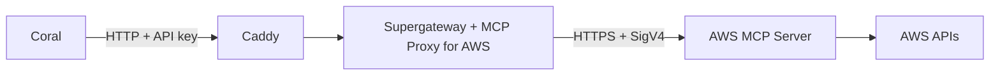

The [AWS MCP Server](https://docs.aws.amazon.com/agent-toolkit/latest/userguide/getting-started-aws-mcp-server.html) is a remote MCP server that AWS runs. Coral can connect to it in two ways:

- **OAuth.** The **AWS** provider in Coral's catalog signs each member in with AWS. Use it when each member has an AWS sign-in. AWS keeps a sign-in for [at most 12 hours](https://docs.aws.amazon.com/agent-toolkit/latest/userguide/oauth-authentication.html#oauth-token-lifecycle). After that, you reconnect the account in Coral.
- **IAM.** Coral calls AWS with one IAM role or user. Use it when you want a fixed identity with its own IAM policies, or access that does not need a new sign-in every 12 hours. This guide covers this option.

With IAM, each request to the AWS MCP Server is signed with [AWS Signature Version 4](https://docs.aws.amazon.com/IAM/latest/UserGuide/reference_aws-signing.html) (SigV4). You'll need a small bridge next to Coral so requests going to the AWS MCP Server are signed with SigV4.

The bridge uses three existing tools in two containers.

- [MCP Proxy for AWS](https://github.com/aws/mcp-proxy-for-aws) signs each request with the bridge's AWS credentials and sends it to the AWS MCP Server.
- [Supergateway](https://github.com/supercorp-ai/supergateway) runs the proxy, serves it as a Streamable HTTP endpoint and checks an API key on each request.
- [Caddy](https://caddyserver.com) sits in front of Supergateway. See [Why the bridge needs Caddy](#why-the-bridge-needs-caddy).



<Warning>
  Every call through this provider uses the bridge's IAM identity, whoever the
  Coral member is. Give that identity only the AWS permissions you want every
  member of the provider to have, and use [permissions](/guides/permissions) to
  decide who can call which tools.
</Warning>

## Before you start

- **A self-hosted Coral deployment.** This guide covers [Docker Compose](/getting-started/self-host/docker-compose) and [Kubernetes](/getting-started/self-host/kubernetes).
- **An AWS Region for the endpoint.** The examples use `https://aws-mcp.us-east-1.api.aws/mcp`. AWS lists the [other Regions](https://docs.aws.amazon.com/agent-toolkit/latest/userguide/getting-started-aws-mcp-server.html#step-2-choose-auth-method).
- **Permission to create an IAM role or user** in the AWS account that the provider reads.

## Set up the bridge

<Steps titleSize="h3">
  <Step title="Create the IAM identity">
    [Create an IAM role](https://docs.aws.amazon.com/IAM/latest/UserGuide/id_roles_create.html) for the bridge. The role's trust policy depends on where the bridge runs. Step 3 links to the AWS page for each platform. Outside AWS, [create an IAM user](https://docs.aws.amazon.com/IAM/latest/UserGuide/id_users_create.html) with an [access key](https://docs.aws.amazon.com/IAM/latest/UserGuide/id_credentials_access-keys.html) instead.

    The AWS MCP Server needs no permissions of its own. Each tool call reaches the AWS service with the bridge's identity, and that service checks the identity's IAM policies. Attach the policies for the access you want. For read-only access, the AWS managed policy `ReadOnlyAccess` is a good start. For a role, attach it with this command:

    ```bash
    aws iam attach-role-policy \
      --role-name coral-aws-mcp \
      --policy-arn arn:aws:iam::aws:policy/ReadOnlyAccess
    ```

    For an IAM user, attach the policy to the user:

    ```bash
    aws iam attach-user-policy \
      --user-name coral-aws-mcp \
      --policy-arn arn:aws:iam::aws:policy/ReadOnlyAccess
    ```

    AWS adds the condition key `aws:ViaAWSMCPService` to each request that the AWS MCP Server makes. To give the identity different permissions through MCP than through direct API calls, see the [AWS policy examples](https://docs.aws.amazon.com/agent-toolkit/latest/userguide/security_iam_id-based-policy-examples.html).

  </Step>
  <Step title="Generate an API key for the bridge">
    Coral sends this key to the bridge as a bearer token. The bridge refuses requests without it.

    ```bash
    openssl rand -hex 32
    ```

  </Step>
  <Step title="Run the bridge">
    <Tabs>
      <Tab title="Docker Compose">
        Add these services to the compose file that runs Coral. Do not publish their ports: only Coral needs to reach them.

        ```yaml
        services:
          aws-mcp:
            image: supercorp/supergateway:4.2.2-uvx
            command:
              - --stdio
              - >-
                uvx mcp-proxy-for-aws-cli@1.8.0
                https://aws-mcp.us-east-1.api.aws/mcp
                --region us-east-1
                --metadata AWS_REGION=us-east-1
              - --outputTransport
              - streamableHttp
              - --stateful
              - --sessionTimeout
              - "300000"
              - --port
              - "8000"
              - --healthEndpoint
              - /healthz
              - --logLevel
              - none
            environment:
              SUPERGATEWAY_API_KEY: ${AWS_MCP_API_KEY}
              AWS_ACCESS_KEY_ID: ${AWS_MCP_ACCESS_KEY_ID}
              AWS_SECRET_ACCESS_KEY: ${AWS_MCP_SECRET_ACCESS_KEY}

          aws-mcp-front:
            image: caddy:2
            configs:
              - source: aws-mcp-caddyfile
                target: /etc/caddy/Caddyfile

        configs:
          aws-mcp-caddyfile:
            content: |
              :8080 {
                @metadata path /.well-known/*
                respond @metadata 404
                reverse_proxy aws-mcp:8000 {
                  flush_interval -1
                }
              }
        ```

        Set these variables in your shell or in the [`.env` file](https://docs.docker.com/compose/how-tos/environment-variables/variable-interpolation/) next to the compose file:

        - `AWS_MCP_API_KEY`: the key from the previous step.
        - `AWS_MCP_ACCESS_KEY_ID` and `AWS_MCP_SECRET_ACCESS_KEY`: the IAM user's access key.

        These names are not the standard AWS variable names. The bridge then never uses AWS credentials that are already set in your shell.

        On Amazon EC2 or Amazon ECS, remove `AWS_ACCESS_KEY_ID` and `AWS_SECRET_ACCESS_KEY` from the service. Keep `SUPERGATEWAY_API_KEY`. On EC2, [attach the role to the instance](https://docs.aws.amazon.com/AWSEC2/latest/UserGuide/attach-iam-role.html). On ECS, set the role as the [task role](https://docs.aws.amazon.com/AmazonECS/latest/developerguide/task-iam-roles.html). The proxy then uses that role. On EC2, also set the instance metadata [hop limit](https://docs.aws.amazon.com/AWSEC2/latest/UserGuide/instancedata-data-retrieval.html#imds-considerations) to `2` so that the container can reach the instance metadata service.

        The bridge's MCP server URL is `http://aws-mcp-front:8080/mcp`.
      </Tab>
      <Tab title="Kubernetes">
        On Amazon EKS, let the role trust the bridge's service account with [IAM roles for service accounts](https://docs.aws.amazon.com/eks/latest/userguide/iam-roles-for-service-accounts.html) or [EKS Pod Identity](https://docs.aws.amazon.com/eks/latest/userguide/pod-identities.html). The example uses IAM roles for service accounts.

        The examples use the `coral` namespace from the [Kubernetes guide](/getting-started/self-host/kubernetes). If Coral runs in another namespace, change `coral` in each command and manifest, and in the bridge's URL. The role's trust policy must name the same namespace and the `aws-mcp` service account.

        Store the API key in a Secret:

        ```bash
        kubectl -n coral create secret generic aws-mcp-auth --from-literal=api-key="<api-key>"
        ```

        Then apply these manifests:

        ```yaml
        apiVersion: v1
        kind: ServiceAccount
        metadata:
          name: aws-mcp
          namespace: coral
          annotations:
            eks.amazonaws.com/role-arn: arn:aws:iam::<account-id>:role/coral-aws-mcp
        ---
        apiVersion: v1
        kind: ConfigMap
        metadata:
          name: aws-mcp-caddy
          namespace: coral
        data:
          Caddyfile: |
            :8080 {
              @metadata path /.well-known/*
              respond @metadata 404
              reverse_proxy 127.0.0.1:8000 {
                flush_interval -1
              }
            }
        ---
        apiVersion: apps/v1
        kind: Deployment
        metadata:
          name: aws-mcp
          namespace: coral
        spec:
          replicas: 1
          selector:
            matchLabels:
              app.kubernetes.io/name: aws-mcp
          template:
            metadata:
              labels:
                app.kubernetes.io/name: aws-mcp
            spec:
              serviceAccountName: aws-mcp
              containers:
                - name: bridge
                  image: supercorp/supergateway:4.2.2-uvx
                  args:
                    - --stdio
                    - >-
                      uvx mcp-proxy-for-aws-cli@1.8.0
                      https://aws-mcp.us-east-1.api.aws/mcp
                      --region us-east-1
                      --metadata AWS_REGION=us-east-1
                    - --outputTransport
                    - streamableHttp
                    - --stateful
                    - --sessionTimeout
                    - "300000"
                    - --port
                    - "8000"
                    - --healthEndpoint
                    - /healthz
                    - --logLevel
                    - none
                  env:
                    - name: SUPERGATEWAY_API_KEY
                      valueFrom:
                        secretKeyRef:
                          name: aws-mcp-auth
                          key: api-key
                  readinessProbe:
                    httpGet:
                      path: /healthz
                      port: 8000
                - name: front
                  image: caddy:2
                  ports:
                    - name: http
                      containerPort: 8080
                  volumeMounts:
                    - name: caddy
                      mountPath: /etc/caddy
              volumes:
                - name: caddy
                  configMap:
                    name: aws-mcp-caddy
        ---
        apiVersion: v1
        kind: Service
        metadata:
          name: aws-mcp
          namespace: coral
        spec:
          selector:
            app.kubernetes.io/name: aws-mcp
          ports:
            - name: http
              port: 8080
              targetPort: http
        ```

        Keep the Service as `ClusterIP`. Do not add an Ingress for it.

        On a cluster that is not Amazon EKS, use an IAM user's access key instead. Remove the `eks.amazonaws.com/role-arn` annotation. Store the access key in a Secret:

        ```bash
        kubectl -n coral create secret generic aws-mcp-credentials \
          --from-literal=access-key-id="<access-key-id>" \
          --from-literal=secret-access-key="<secret-access-key>"
        ```

        Then add these variables to the `env` list of the `bridge` container:

        ```yaml
        - name: AWS_ACCESS_KEY_ID
          valueFrom:
            secretKeyRef:
              name: aws-mcp-credentials
              key: access-key-id
        - name: AWS_SECRET_ACCESS_KEY
          valueFrom:
            secretKeyRef:
              name: aws-mcp-credentials
              key: secret-access-key
        ```

        The bridge's MCP server URL is `http://aws-mcp.coral.svc.cluster.local:8080/mcp`.
      </Tab>
    </Tabs>

    The proxy takes these options:

    | Option | Description |
    | --- | --- |
    | Endpoint URL | The AWS MCP Server endpoint for your Region. |
    | `--region` | The Region the proxy signs for. It must match the Region in the endpoint URL. |
    | `--metadata AWS_REGION=<region>` | The default Region for AWS operations. Change it when your resources are in a different Region from the endpoint. |
    | `--read-only` | Optional. Hides the tools that can write. This includes the run script tool, the only tool that calls AWS APIs, so the documentation and Region tools remain. For read-only access to AWS, use IAM policies instead. |

    The examples set `--logLevel none`. Without it, Supergateway writes each MCP request and result to the container's logs, which puts AWS data there. The option also hides the proxy's error messages. Remove it while you debug the bridge.

    The `4.2.2-uvx` and `1.8.0` versions are examples. Check [Supergateway's tags](https://hub.docker.com/r/supercorp/supergateway/tags) and the [proxy's releases](https://github.com/aws/mcp-proxy-for-aws/releases) for newer ones.

  </Step>
  <Step title="Let Coral reach the bridge">
    With `[auth]` configured, Coral denies provider calls to private network addresses. The bridge has a private address and serves plain HTTP, so add the [`[outbound]`](/reference/configuration#outbound) policy to Coral's configuration. In the Docker Compose guide, that is the `CORAL_CONFIG` value in the compose file. In the Kubernetes guide, it is the `config.toml` key of the Coral ConfigMap.

    ```toml
    [outbound]
    private_networks = "http-and-https"
    ```

    Then recreate the Coral container, or restart the Coral Deployment.

    <Note>
      Over plain HTTP, the API key is not encrypted between Coral and the
      bridge. Use it only where you trust the network between them, such as the
      compose project's own network. The policy also applies to every provider:
      a workspace owner can then add a provider at any private address that
      Coral can reach. To avoid both, serve the bridge over TLS, keep the
      `https` policy and use the bridge's `https://` URL in the next step.
    </Note>

  </Step>
  <Step title="Add the provider to Coral">
    1. Go to your workspace's **Providers** page.
    1. Click **Add provider**, then **Add custom**.
    1. Enter the bridge's MCP server URL, then click **Connect**.
    1. Enter a display name and a namespace, such as `AWS` and `aws`. You cannot change the namespace later.
    1. For **Sign-in**, choose **Bearer token**. Click **Next**.
    1. Click **Enter a token to read the tools**. Enter the API key from step 2, then click **List tools**.
    1. Click **Next**. Under **One shared account**, choose **Use this account**.
    1. Click **Add provider**.
  </Step>
</Steps>

## Check the connection

Open the provider in Coral. It lists the AWS MCP Server's tools, such as `awsRunScript` and `awsSearchDocumentation`.

Then ask your agent which AWS account it uses through Coral. The answer names the bridge's IAM identity.

`awsRunScript` and `awsGetPresignedUrl` are not read-only tools, so each call waits for your approval. To change that, set each tool's policy on the provider's page. See [permissions](/guides/permissions).

## Why the bridge needs Caddy

When a server asks for credentials, Coral looks for the server's OAuth metadata under `/.well-known/`. A server without OAuth must answer `404` there. Coral then offers the other sign-in methods, such as **Bearer token**.

When the key is missing, Supergateway answers `401` on every path except its health endpoint. Coral then stops the setup. Caddy answers `404` on the `/.well-known/` paths and passes every other request to Supergateway, which still checks the key.

## Troubleshooting

With `--logLevel none`, the bridge logs nothing. Remove the option to see the errors in the bridge's logs.

| Problem                                                    | What to do                                                                                                           |
| ---------------------------------------------------------- | -------------------------------------------------------------------------------------------------------------------- |
| "Coral's outbound settings do not allow this address."     | Add the `[outbound]` policy to Coral's configuration, then restart Coral.                                            |
| "Coral cannot read this server's OAuth resource metadata." | The URL reaches Supergateway directly. Use the Caddy URL, on port `8080`.                                            |
| The bridge returns `401 Unauthorized`                      | The token in Coral does not match `SUPERGATEWAY_API_KEY`. Connect the account again with the correct key.            |
| `No AWS credentials found` in the bridge's logs            | The proxy found no credentials. Check the environment variables, the instance profile or the service account's role. |
| `InvalidSignatureException` in the bridge's logs           | `--region` does not match the Region in the endpoint URL, or the container's clock is wrong.                         |
| A tool returns an access denied error                      | The bridge's IAM identity lacks the permission. Attach a policy that grants it.                                      |
| The first call after a restart is slow                     | The bridge downloads the proxy when it first runs it. Later calls are faster.                                        |

For other errors, see [AWS's troubleshooting table](https://docs.aws.amazon.com/agent-toolkit/latest/userguide/getting-started-aws-mcp-server.html#troubleshooting-auth-errors).
