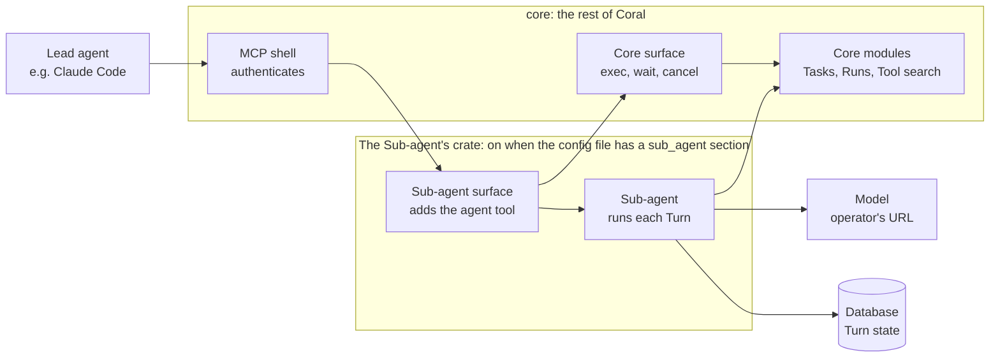
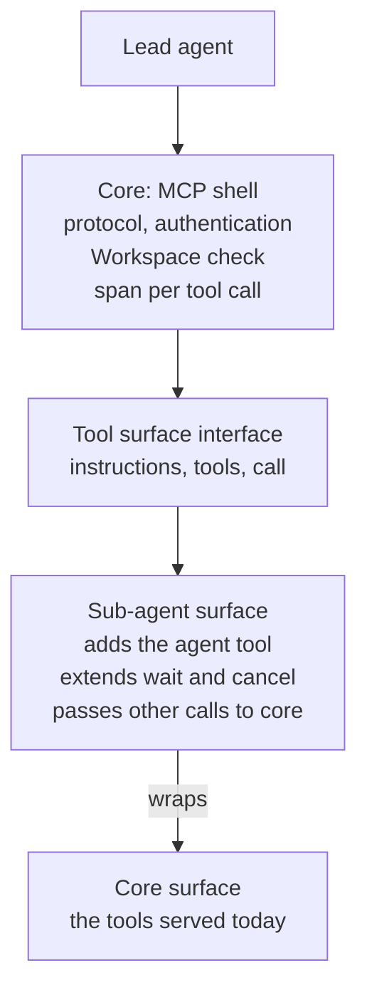
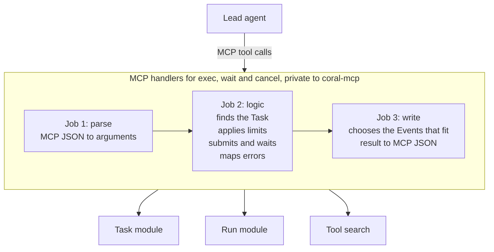
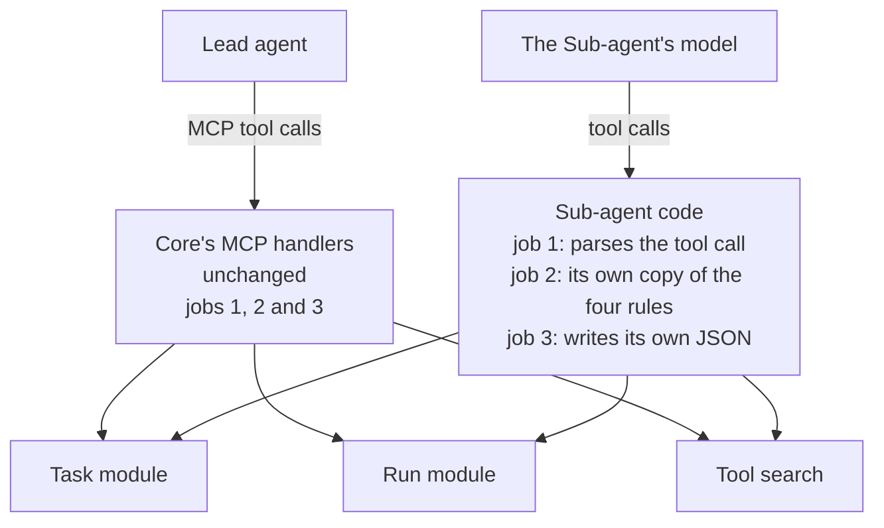
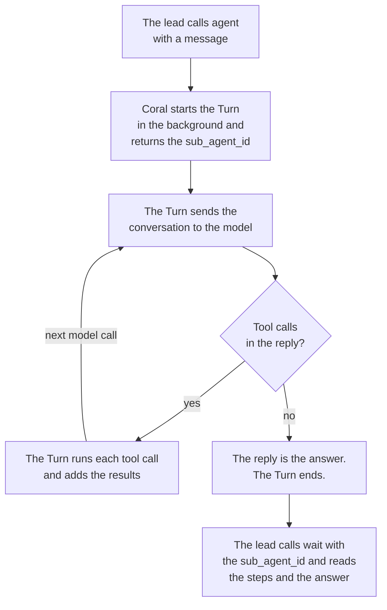

# A Sub-agent does data work for the agent that calls it

Some teams want data work kept in-house, for privacy and for cost. Today a lead agent such as Claude Code does that
work itself, finding Tools, writing Programs and reading results, and sends provider data to a hosted frontier model at
every step. The lead calls Coral's Sub-agent through one more MCP tool, `agent`, and watches or stops it with its
existing `wait` and `cancel` tools. Every build of Coral has the Sub-agent, and it is off until the operator configures
a model for it. Its code lives in one crate of its own, and the rest of Coral gains only general extension points.

## What we cared about

We held to these eleven points while we made the decisions below. Each decision names the points it serves.

1. We did not invent a new way to configure an external service. The model is configured the way the database
   connection is.
2. We did not interrupt normal service when no model is configured.
3. We did not wait for changes to the user interface.
4. We wanted something testable as soon as possible.
5. We kept the Sub-agent in one crate, so that it can be removed or moved without changing the rest of Coral.
6. We made the Sub-agent robust to changes in Coral's MCP tools, so that a trained model does not stop working soon
   after it is trained.
7. We gave the Sub-agent no permissions of its own.
8. We kept Coral's rule that no instance holds session state.
9. We did not keep two copies of core's logic.
10. We did not add limits or settings that we could only guess at.
11. We made sure that the lead can check an answer from the Run itself.

## The design at a glance



The lead's request enters through core's MCP shell and reaches the Sub-agent's surface. A call to `agent` starts a
Sub-agent Turn, and every other call passes to the core surface. The Sub-agent sends the conversation to the model, and
it reaches Tasks, Runs and Tool search by calling core's modules directly, as core's own tools do. In this record, core
means the rest of Coral: every crate but the Sub-agent's.

The sections below give each decision, the points it serves, and the alternatives we rejected. The appendix at the end
explains how each part works in detail.

## Decisions

### 1. The Sub-agent is one crate that wraps core's MCP tools

**Serves points 2 and 5.**

We will keep all Sub-agent code in one crate, `coral-sub-agent`. Core's MCP shell will ask a tool surface interface,
`McpInterface`, for the instructions, for the list of tools, and to run each tool call. Core will supply the default
implementation, which serves the tools that Coral serves today. The Sub-agent's crate will supply a second
implementation that wraps the first. It adds the `agent` tool, lets `wait` and `cancel` accept a `sub_agent_id`, and
passes every other call to core unchanged.



The `coral` process, which every binary runs, will register that implementation through `Extensions`, the way a binary
adds anything to Coral (ADR 0033). The Sub-agent's tables are in core's migration chain. Nothing else in core names the
Sub-agent. To remove it, we delete the crate and the registration. To make it an Enterprise Feature, we move the crate
to `ee/` and register it there.

The lead sees the Sub-agent only when the config file has a `[sub_agent]` section. Without the section, it receives
exactly the tools and instructions that Coral serves today.

| `[sub_agent]` in the config file | Tools the lead sees                                                           |
| -------------------------------- | ----------------------------------------------------------------------------- |
| absent                           | `exec`, `wait`, `cancel`, `end_task`                                          |
| present                          | the same tools plus `agent`; `wait` and `cancel` also accept a `sub_agent_id` |

**Rejected:**

- **Ship the Sub-agent as an Enterprise Feature.** We decided this first: the crate lived in `ee/` and checked the
  Edition on every call. The Sub-agent starts in every build instead. It is still one crate behind the tool surface
  interface, so this choice stays cheap to reverse.
- **Wire the Sub-agent into core's MCP server, with no tool surface interface.** Code outside `ee/` may do that. But
  the Sub-agent's code would then be spread through core's MCP handlers, and removing it or moving it to `ee/` would
  mean taking those handlers apart.

### 2. A Sub-agent runs with its caller's permissions

**Serves points 7 and 11.**

We will give a Sub-agent no identity and no permissions of its own. It runs with the permissions of the agent that
called it, inside that agent's Task. Each Run it starts is recorded as the calling agent's Run and is checked by the
same Policy Enforcement Point.

Because those Runs belong to the lead's own Task, the lead can check an answer for itself. Each result from `wait`
lists the steps the Sub-agent took. A step that started a Run holds the intent the Sub-agent gave for it and its
`run_id`, and nothing else. The lead reads that Run's Program and Final Value with `wait`.

**Rejected:**

- **A summary of evidence that the Sub-agent writes for the lead.** The lead can already read the Run itself.
- **A summary under the steps of what each Run called**, such as calls for each Provider, refused calls and pages not
  read. It would show a mistake at a glance, but core would need a new read of a Run's calls to supply it. The lead
  reads the Run when it wants that detail.

### 3. The Sub-agent calls core's Task and Run modules directly

**Serves point 6. It goes against point 9 in a small way, which is described below.**

Today, each of the MCP handlers `exec`, `wait` and `cancel` is one private function that does three jobs. It parses the
MCP arguments, it carries out the request, and it writes the result as MCP JSON.



The second job is small. It holds four rules:

- A Run with no time limit gets 15 minutes, and a call that starts a Run waits up to 30 seconds for it.
- The wait is checked before anything starts, so a refused wait starts no Run.
- A Run that started is always reported, even when Coral cannot read it back in the same call.
- Each failure becomes a code and a message for the agent.

The checks that decide what a caller may do are not in the handlers. They are in the Task and Run modules, and every
caller passes through them.

We will leave core's `exec`, `wait` and `cancel` handlers as they are. The Sub-agent's code will call the Task and Run
modules directly, as the handlers do. It will apply the same four rules in its own code, and it will choose its own
wording for each failure.



A Run that a Sub-agent starts passes the same permission checks and the same Policy Enforcement Point as a Run started
over MCP, because both go through the same modules. The wording of a failure joins the rest of what the Sub-agent's
model reads: the Sub-agent's crate chooses it, so a change to the wording of core's MCP tools does not reach a trained
model.

This goes against point 9 in a small way. The four rules exist twice, once in core's handlers and once in the
Sub-agent's crate. A change to one of them in core is repeated there by hand, and the two sets of tools can word the
same failure differently.

**Rejected:**

- **Move the second job into shared functions that both sets of tools call.** We decided this first, and built it as a
  crate with one function for each tool. It keeps one copy of the four rules and of the failure wording. But it needs a
  rewrite of core's MCP handlers in order to share four small rules, and it makes core's failure wording part of what a
  trained model reads.
- **Make core's existing MCP handlers public.** Their argument types define the MCP tool schemas, so a change to an MCP
  tool's arguments would break the Sub-agent.
- **Have the Sub-agent call the MCP tools and read fields from their JSON results.** The Sub-agent's model would then
  read core's MCP JSON, and a renamed field would fail only when a call ran.

### 4. The text that the Sub-agent's model reads is written in the Sub-agent's crate

**Serves point 6.**

A model can be trained by reinforcement learning against the Sub-agent's tools. It learns the exact tool names,
argument names and result fields that it is shown, and it keeps using them after they change.

We will therefore write three things in the Sub-agent's crate: the system prompt, the definition of each tool the model
can call, and the code that writes each tool result, including the wording of each failure. The Sub-agent's model will
never receive core's MCP instructions or core's MCP tool descriptions, which change to suit outside agents.

When a change in core alters a value that the Sub-agent's crate reads, the crate stops compiling in the same pull
request. The author then updates it so that the model reads what it read before.

**Rejected:** a checked-in file of hashes of that text, verified in CI. It would only report a change, and the quickest
way to satisfy such a check is to update the file.

### 5. The Sub-agent has its own search tool, and its Programs cannot call Built-in Tools

**Serves point 6.**

Outside agents find Tools by calling the Built-in Tool `coral.search` from inside a Program (ADR 0026), and core
changes `coral.search` to improve how they do it. Search is also the only Tool an agent must know how to call in
advance, because an agent finds every other Tool by searching.

We will give the Sub-agent's model a `search` tool that the Sub-agent's crate defines. It runs the same search by
calling core's search module directly. We will also refuse any Sub-agent Program that calls a Built-in Tool, including
`coral.search`. If `coral.search` worked inside a Program, a model could learn during training to call it there, and it
would depend on core's names again.

As a result, a Sub-agent cannot add a Provider, change policy or save a Private Tool, even when its caller is permitted
to. The lead does those things itself.

This does not reverse ADR 0026, which rejected serving search through two interfaces and choosing between them by
detecting the client. Core's MCP tools do not change, Coral does not detect the client, and core still has one
implementation of search.

**Rejected:**

- **Add code to the start of each Program that wraps `coral.search`.** The Program recorded for each Run would contain
  code that the model did not write, and the model could still call `coral.search` directly.
- **Forbid changes to `coral.search`.** ADR 0026 depends on changing it.

### 6. The operator configures the model in the config file, as it configures the database

**Serves points 1, 2, 3 and 10.**

We will add a `[sub_agent]` section to the config file that works as `[database]` does. The deployment owns the
section, a `*_env` key names the environment variable that holds the secret, and a change takes effect when Coral
restarts. The presence of the section turns the Sub-agent on. No key enables it separately.

The model is any endpoint that implements OpenAI's Chat Completions API. Coral does not check which model answers, and
the Sub-agent has one model client. Coral does not call the model at startup, so an unreachable model does not stop
Coral from starting.

The settings exist only in the config file. Reef has no form for them, and Coral does not store them in its database.

We will add one optional reasoning setting, `reasoning_effort`, which decision 9 describes, and no limit other than a
fixed number of model calls in one Turn. Without that setting, the model server's own defaults decide whether the model
reasons. Limits on running Turns, tokens and duration wait until usage shows what they should be.

**Rejected:**

- **A default model URL.** A config file that set only a model name would send provider data to a host that nobody
  chose.

### 7. A Turn runs in one Coral Instance and is never resumed

**Serves point 8.**

A Turn is the work a Sub-agent does between receiving one message and sending its response. We will run each Turn as a
background task in the Coral Instance that accepted the `agent` call. The Turn's state is stored in the database under
a lease, so any Coral Instance can answer a `wait` or a `cancel` for it.

We will not resume a Turn on another Coral Instance. A Turn runs with its caller's permissions, and Coral stores no
caller credential (ADR 0029), so another instance has nothing to continue with. When a Coral Instance shuts down, it
marks its Turns as interrupted. The lead then sends the Sub-agent a new message, and a new Turn starts with the stored
conversation.

**Rejected:** resuming an interrupted Turn on another Coral Instance. It would need a way to act as the caller with no
request from the caller, which is a separate design.

### 8. The first release changes nothing in Reef and adds no usage reporting

**Serves points 3 and 4.**

We will ship the Sub-agent with no page and no form in Reef. The Runs that a Sub-agent starts appear in Reef as its
caller's Runs. We will add nothing to the Usage Report, because those Runs are already counted there.

We will test the Sub-agent with Rust tests that use a stub in place of the model. The Sub-agent stays off in every
deployment until its operator adds the `[sub_agent]` section.

The Sub-agent will record a trace and metrics for each Turn through names that core's `coral-telemetry` crate declares.
They contain counts, token numbers and durations, and never text.

### 9. The Sub-agent speaks one protocol, and sends every request through Coral's guarded client

**Serves points 6 and 10.**

The Sub-agent has one model client, which is Coral's own code. It speaks OpenAI's Chat Completions API. The Sub-agent
is built for a model that the operator hosts, and on vLLM that one protocol carries everything the Sub-agent uses: tool
calls, reasoning and prompt caching.

Two hosted providers keep features off that protocol. We met both when we measured the Sub-agent with hosted models.

| Provider | What does not work over Chat Completions | What we do |
| --- | --- | --- |
| Anthropic | Prompt caching. Its OpenAI-compatible endpoint does not support it, and Anthropic describes that endpoint as a way to test and compare models, not as a production API. | Nothing. A Claude model works, and each model call pays in full for the whole conversation. |
| OpenAI | Reasoning together with tools. From GPT-5.4 on, Chat Completions refuses a request that has tools unless `reasoning_effort` is `none`. A Sub-agent's requests always have tools. | One optional setting, `reasoning_effort`, so that such a model works with reasoning off. |

`reasoning_effort` is the only reasoning setting. When the operator sets it, Coral sends it with every request to the
model and does not interpret its value. When it is not set, Coral sends no reasoning setting. On vLLM, leave it unset:
for a Qwen model it turns thinking on but does not keep the model's earlier reasoning in view, so the model loses that
reasoning whenever the lead sends a follow-up.

Every request to the model goes through the guarded client of `coral-outbound`, under the operator's `[outbound]`
policy (ADR 0008). A self-hosting operator writes the model's URL, but we do not treat it as an operator-authored
endpoint, which `coral-outbound` lets a plain HTTP client call. In a SaaS deployment the URL comes from an
organization, and an organization's administrator may later set it in the product.

**Rejected, or left until a hosted model is wanted as a real Sub-agent model:**

- **A second client, for Anthropic's Messages API.** It would give a Claude model caching and control of its thinking.
  Each added protocol brings its own rules for reasoning and caching, its own tests, and its own failures to word.
- **A client for OpenAI's Responses API.** It is the only way an OpenAI model reasons while it uses tools. OpenAI
  returns reasoning there as encrypted items that the caller stores and sends back exactly, which the stored
  conversation does not hold yet. vLLM serves this API too, but it is newer there than Chat Completions, and we have
  not run Sailfish through it.
- **Moving every model to the Responses API.** Sailfish on vLLM would move to the less proven path, and many servers
  that call themselves OpenAI-compatible serve only Chat Completions.
- **A library that speaks each provider's own API, such as rig.** This is the choice to make when a second provider is
  needed, because three protocols are more than Coral should write by hand. rig lets its caller supply how a request is
  sent, so its requests can pass through the guarded client, the way `rmcp`'s do for Provider calls. We did not take it
  now: one protocol is a few hundred lines of Coral's own code, rig is before 1.0 and releases often, and we have not
  measured what it costs to store and send back each provider's reasoning. Conversations are stored in Coral's own
  format, so the model client can be replaced later with no migration.
- **genai, a lighter library of the same kind.** It sends each request through a plain HTTP client that its caller
  hands it, with no place to check a request first. `coral-outbound` allows a plain client only for a URL that an
  operator wrote, and the model's URL is not one.
- **Handing a library the HTTP client inside the guarded client.** `coral-outbound` keeps the URL check and the DNS
  check in one client on purpose, and nothing takes its inner client today.
- **A gateway in front of the model, as Coral's own answer.** A gateway such as LiteLLM, agentgateway or Bifrost takes
  Chat Completions requests and calls each provider's own API, with caching. An operator can run one today with no
  change to Coral. Coral does not ship one or require one.

## Consequences

**What gets better**

- A change to core's MCP tools no longer changes what the Sub-agent's model reads.
- Core's `exec`, `wait` and `cancel` handlers do not change.
- A deployment with no `[sub_agent]` section behaves as it does today.
- A source build has the Sub-agent too, so anyone can run it and test it against their own model.
- An operator configures the model the way it already configures the database.

**What we accepted**

- A Workspace Owner cannot turn the Sub-agent off for one Workspace. It is on for the whole deployment.
- A Sub-agent cannot administer Coral, even when its caller can.
- An interrupted Turn does not continue. The lead must send its message again.
- Program diagnostics and Tool declarations still come from core, so a change to them changes what the model reads.
- The four rules behind `exec`, `wait` and `cancel` exist twice, in core's handlers and in the Sub-agent's crate. A
  change to one of them in core is repeated there by hand.
- Removing the Sub-agent later leaves its tables in the database until a later migration drops them.
- Coral does not record which version of the prompt and tool definitions a model was trained on. A team that trains a
  model records the Coral release.
- With a hosted API, the operator cannot set the server's defaults. The model reasons at the provider's default level
  unless the operator sets `reasoning_effort`.
- An OpenAI model from GPT-5.4 on works as a Sub-agent's model only with reasoning off.
- To reach a model on a private network, the operator opens that network in `[outbound]`, which opens it for Provider
  calls too. A separate allowance for the model could remove this later.
- A Claude model reached through Anthropic's OpenAI-compatible endpoint gets no prompt caching. Each model call then
  pays in full for the whole conversation. A gateway that calls Anthropic's own API can add caching.
- Coral does not check that the model server is up. It does not call the model at startup, and it does not probe it
  while it runs. While the model server is down, `agent` stays listed, the lead is still told to hand work to a
  Sub-agent, and each Turn fails after three retries. Coral could be more robust here: vLLM serves `/health`, and `GET
  /models` works on any server that speaks Chat Completions. We left that out while we evaluate the Sub-agent.
- Reef shows no Sub-agents and no Turns.

**What we are not sure of**

- The Sub-agent's own `search` tool has not been measured. ADR 0026 measured search outside Programs as slower for
  outside agents.
- Sailfish, Coral's own model, was trained to call `coral.search` inside a Program. It will take extra steps until it
  is retrained against the Sub-agent's tools.

## How we will confirm it

- A test shows that the lead receives only core's tools when the config file lacks the section.
- A test shows that a Turn starts a Run in the lead's Task and `wait` returns the answer.
- Tests compare the system prompt, the tool definitions and a written result against the exact expected text.
- A developer runs a Turn with several steps and a compaction against Sailfish with reasoning turned on, before the
  Sub-agent is turned on for anyone.

## Related records

- ADR 0033 gives a binary `Extensions`, the way it adds to Coral. The Sub-agent's tool surface is registered through
  it.
- ADR 0026 moved Tool search into Programs for outside agents.
- ADR 0029 says that Coral keeps no MCP session.
- ADR 0008 sets the operator's destination policy for outbound requests, which the Sub-agent's requests to the model
  follow.
- The tickets of [Decide how Coral's agent ships](https://github.com/withcoral/coral/issues/3198) hold the detail
  behind each decision.

## Appendix: how it works

This appendix explains how each part of the Sub-agent works. It describes the design at the time of this record, and
the code will later state much of it exactly.

### What the Sub-agent's tools call in core

Each of the Sub-agent's tools is code in its crate that calls a core module as the lead's caller:

| The Sub-agent's tool | What its code calls in core                                                             |
| -------------------- | --------------------------------------------------------------------------------------- |
| `exec`               | the Task module, which records the attempt and accepts the Program, then the Run module |
| `wait`               | the Run module, to read a Run after a cursor                                            |
| `cancel`             | the Run module, to cancel a Run and read it                                             |
| `search`             | the search module, for the discovery that the Built-in Tool `coral.search` runs         |

These are the calls that core's own MCP handlers and Built-in Tools make. The Sub-agent gets no entry point of its own.

The Sub-agent chooses how much of a Run's output fits in one result, and it chooses the wording of each failure. Where
a core module supplies text that is safe to show, such as a Program's diagnostics, the Sub-agent includes that text.
For a failure that it has no wording for, the model reads one general message.

### How the call stack changes

The three listings below follow one `exec` call. Indentation shows which function calls which. Each line is marked with
the job it belongs to: job 1 parses the arguments, job 2 is the logic, and job 3 writes the result. Job 2 is the part
that the Sub-agent writes for itself.

Today on `main`, the lead calls `exec`:

```text
McpServer::call_tool                     MCP shell: authenticated request, opens the span
  McpServer::dispatch                    picks the handler by tool name
    arguments::parse::<ExecArguments>    job 1: MCP JSON to arguments
    McpServer::exec                      job 2: finds the Task, applies defaults and limits
      commands.submit                    job 2: the Task module accepts the Program
      McpServer::observe                 job 2: the Run module waits for the Run
      projection::run_update             job 3: chooses the Events that fit in one result
                                         job 3: writes the result as MCP JSON
```

Decided, the lead calls `exec`:

```text
MCP shell: call_tool                     unchanged
  tool surface interface: call           the Sub-agent's surface passes exec to the core surface
    core surface: exec                   unchanged: jobs 1, 2 and 3, as in the listing above
```

Decided, the Sub-agent's model calls `exec`:

```text
Turn loop, in the Sub-agent's crate
  Sub-agent code: parse                  job 1: the model's tool call to values
  Sub-agent code: check the Program      refuses a Built-in Tool
  Sub-agent code: exec                   job 2: its own copy of the four rules
    Task module: submit                  the same call that core's handler makes
    Run module: observe
  Sub-agent code: write                  job 3: Run Update to the JSON the model reads
```

The function names in the "today" listing are the real ones. The two "decided" listings describe what each step does,
because that code is not written yet.

### What the Sub-agent receives at startup

The `coral` process registers the factory for the Sub-agent's tool surface through `Extensions`, in the same way that a
binary registers a Secret Store kind. At startup, when the config file has the factory's section, core calls the
factory and gives it:

- the `[sub_agent]` section of the config file, as unparsed TOML;
- the database, and the Task, Workspace, Run and search modules;
- the operator's destination policy for outbound requests;
- a signal that fires when the Coral Instance shuts down.

Core does not know the name of the section. If the config file contains a section that no factory claims, startup
fails.

The Sub-agent's database tables are created by core's migration chain, and their names start with `sub_agent_`. Every
query that reads or writes them is in the Sub-agent's crate.

### What the Sub-agent's model reads, and where it is written

| What the Sub-agent's model reads | Where it is written | Learned in training |
| --- | --- | --- |
| The system prompt | the Sub-agent's crate | Yes |
| The name, description and argument schema of `search`, `exec`, `wait` and `cancel` | the Sub-agent's crate | Yes |
| The field names of each tool result | the Sub-agent's crate | Yes |
| The declaration of a Provider, Private or Shared Tool, returned by `search` | core | No. The model reads it each time it searches. |
| The wording of each failure | the Sub-agent's crate | No. The model reads each one when it occurs. |
| Program diagnostics, and other text that a core module marks as safe to show | core | No. The model reads each one when it occurs. |

The first version of that text starts from what core serves today:

- The descriptions of `exec`, `wait` and `cancel` are copies of core's current descriptions, with three parts removed:
  the `goal` argument, the instruction to show a required action's URL to the user, and the paragraph about
  `coral.search`.
- Each tool result uses the same field names as core's MCP result for the same tool.
- A tool result longer than 20 KiB is shortened to its first 10 KiB and its last 10 KiB.

### What a Sub-agent's Program may call

Before the Sub-agent starts a Run, it checks the text of the Program for the Tools it calls:

| The Program calls | What happens |
| --- | --- |
| A Provider Tool (`coral.providers.…`) | Allowed |
| A Private Tool (`coral.private.…`) | Allowed |
| A Shared Tool (`coral.shared.…`) | Allowed |
| `coral.emit` or `coral.ToolError` | Allowed |
| A Built-in Tool, such as `coral.search`, `coral.addCustomTool`, `coral.addProvider` or `coral.updatePolicy` | The Program is not run. The model receives an error that names the Tool. For `coral.search`, the error tells it to call `search`. |

A Built-in Tool that core adds later is refused in the same way, until someone changes the Sub-agent to allow it. A
Sub-agent can still call a Provider Tool that writes data, such as one that posts a comment, when its caller's policy
allows it.

The check finds Call Paths that are written out in the Program. It does not find a Call Path that the Program builds
while it runs.

### How a change in core affects the Sub-agent's model

| Change in core | Effect on the Sub-agent's model |
| --- | --- |
| An MCP tool's name, description, argument schema or result field changes, or an MCP tool or argument is added | None. The Sub-agent does not use them. |
| The arguments or result fields of `coral.search` change | None. If the change alters a Rust type that the Sub-agent uses, its crate stops compiling, and the author updates it so that the model's `search` tool stays the same. |
| A Built-in Tool is added | None. A Sub-agent's Program cannot call it, and `search` does not return it. |
| A field is added to a Run Update | None, until someone changes the Sub-agent to include it in a result. |
| A call that the Sub-agent makes on the Task, Run or search module gains an input | Its crate stops compiling. The author decides what value it passes. |
| A value that the Sub-agent reads is removed, or its type changes | Its crate stops compiling. The author updates it. |
| A Run state, Event kind or required-action kind is added | The Sub-agent's crate stops compiling. The author writes the text the model reads for it, or leaves that Event out of results. |
| The wording of a failure in core's MCP tools changes | None. The Sub-agent chooses its own wording. |
| A kind of failure is added in core | The model reads the Sub-agent's general message for it, until someone gives it its own wording. |
| A Program diagnostic or a Tool declaration changes | The model reads the new text. |

The Sub-agent handles every Run state, Event kind and required-action kind by name and has no default case. That is why
adding one stops its crate compiling, in the same pull request that adds it.

### The `[sub_agent]` section of the config file

```toml
[sub_agent]
base_url = "https://sailfish.example/v1"   # required, no default
model = "sailfish-1"                        # required
api_key_env = "CORAL_SUB_AGENT_API_KEY"     # optional: the environment variable that holds the token
context_window = 131072                     # optional: the model's context window, in tokens
reasoning_effort = "none"                   # optional: sent with every request when set
```

- `api_key_env` names an environment variable, as every other secret in the config file does. If it is set and the
  variable is missing, startup fails. If it is not set, Coral sends no `Authorization` header.
- Requests to the model go through `coral-outbound` and follow the operator's `[outbound]` destination policy, with no
  exception for the Sub-agent. A model on loopback or on a private network must be allowed there.
- The Sub-agent is on for every Workspace in the deployment.
- The party that runs the deployment writes the section. For a self-hosted deployment, that is the operator. For a SaaS
  deployment, it is Coral's control plane.

### What the model server must do

The Sub-agent has one model client, built and tested against vLLM. Other servers that implement Chat Completions and
return tool calls in the `tool_calls` field should work, but they are not tested.

| Requirement | Reason | vLLM flags |
| --- | --- | --- |
| Return tool calls in the `tool_calls` field of the reply | Coral does not parse tool calls out of the reply's text. | `--enable-auto-tool-choice` and `--tool-call-parser` |
| For a reasoning model, return reasoning in the `reasoning` or `reasoning_content` field of the reply | Coral does not parse `<think>` tags out of the reply's text. Without this, Coral treats the reasoning as part of the Sub-agent's answer and can show it to the lead. | `--reasoning-parser` |
| Turn reasoning on or off in the server's own defaults | Coral sends no reasoning setting unless the operator sets `reasoning_effort`. | `--default-chat-template-kwargs` |

Coral sends no caching setting. A server that caches a repeated prompt by itself, as OpenAI's API does, caches the
Sub-agent's conversation, and Coral records the cached input tokens that the server reports. Anthropic's
OpenAI-compatible endpoint does not cache.

Coral stores each Sub-agent's conversation in its own format, as a list of typed blocks: text, a tool call, a tool
result with an error flag, reasoning, and a compaction summary. The client converts between this format and Chat
Completions messages on every request. Chat Completions messages are not used for storage because they cannot hold a
tool result's error flag, reasoning or a compaction summary.

Coral keeps reasoning in the stored conversation. It sends reasoning back to the model only when the model that wrote
it is the model named in the config file. It never includes reasoning in the response to the lead.

### The steps of one Turn

When the lead calls `agent`, the Coral Instance that receives the call starts the Turn as a background task and returns
the `sub_agent_id`. The lead then calls `wait` with that `sub_agent_id` to read the Sub-agent's progress and its
answer.

During a Turn, the Sub-agent repeats two steps. It sends the conversation to the model. It then runs the tool calls in
the model's reply and adds their results to the conversation. The Turn ends when the model replies without a tool
call, and that reply is the Sub-agent's answer.



| Situation | What happens |
| --- | --- |
| The lead calls `cancel` with the `sub_agent_id`, on any Coral Instance | The call records the cancellation in the database. The Turn stops when it next renews its lease, and the Coral Instance that runs it cancels the Runs it started that have not ended. |
| The lead ends the Task | A running Turn in it stops as canceled, at its next model call or when it next renews its lease, and its unfinished Runs are cancelled. |
| The lead sends another message while the Turn is running | The Sub-agent reads the message before its next model call. |
| A Run that the Turn started waits for a person to approve a Tool call or connect an account | `wait` returns `needs_action` with that Run's required actions, and the lead shows them to the user. |
| The conversation comes close to the model's context window | The Sub-agent asks the model to summarize the older messages. It continues with the summary and the most recent messages. |
| The model server returns HTTP 429 or a 5xx status, or the request fails to send | The client retries three times. If the request still fails, the Turn fails with the model server's error, and the lead can send the message again. |
| The Turn makes 60 model calls without finishing | The Turn fails. The error tells the lead to send a narrower message. |
| The Coral Instance shuts down | It marks its running Turns as interrupted before it exits. |
| The Coral Instance stops without shutting down | The Turn's lease in the database expires. The next request that reads the Turn marks it as interrupted. |

A Run that an interrupted or failed Turn started continues under its Run Owner. Only a canceled Turn cancels its Runs.
A Turn itself does not use a Run Owner or a Run Executor, because those run Programs. A Turn only calls the model and
core's Task, Run and search modules.

### What telemetry records

Each Turn produces one trace. The root span of that trace links to the span of the `agent` call that started the Turn.
Inside the trace there is one span for each model call, each tool call and each compaction. Each Run that the Turn
starts has its own Run Trace, which links to the tool-call span that started it.

| Signal | What it contains |
| --- | --- |
| Turn span | the Workspace, the Principal, the Task, the `sub_agent_id`, how the Turn ended, and the number of model calls, tool calls and compactions |
| Model-call span | the model name from the config file, the model host, token counts, the finish reason, the number of retries, and the HTTP status of a failed call |
| Tool-call span | the tool name, how the call ended, and the `run_id` if it started a Run |
| Compaction span | the token count before and after |
| Metrics named `coral.sub_agent.*` | Turns ended, Turn duration, Turns running, model calls per Turn, model-call duration, tokens per model call, and compactions |

No span or metric contains a message, a prompt, tool arguments, a tool result, the model's text, the model's reasoning
or the model server's error text. No metric has the model name, a Workspace or an ID as an attribute.

The names of these fields and metrics are declared in core's `coral-telemetry` crate, and the Sub-agent records values
through them. A test runs core's telemetry source check over the Sub-agent's code.

### The order of rollout

1. The code merges to `main`. No deployment has a `[sub_agent]` section yet, so the Sub-agent is off everywhere.
2. A developer runs a Turn with several steps and a compaction against Sailfish with reasoning turned on. This checks
   the model's chat template and the server's parsers, which a stub cannot check. A plain build of `main` is enough.
3. The Coral team's self-hosted deployment turns the Sub-agent on, with a `[sub_agent]` section that points at
   Sailfish.
4. SaaS deployments get the Sub-agent when Coral's control plane can write the section and the token. That work is
   outside this repository.

The Sub-agent has no Reel scenario, because it changes nothing in Reef.
